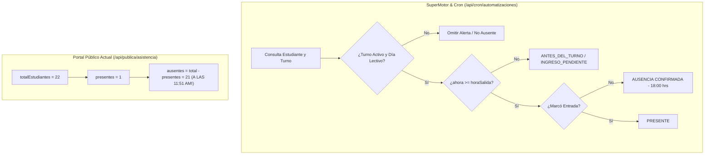

# AUDITORÍA FORENSE URGENTE — CÁLCULO DE INASISTENCIAS DEL PORTAL PÚBLICO
## SISTEMA INTELIGENTE DE ASISTENCIA ESCOLAR

**Fecha y Hora de la Auditoría:** 09 de Septiembre de 2026, 12:15 PM (America/Lima)  
**Institución Analizada:** I.E.P. Santa Rita de Casia (`SANTA_RITA_001`)  
**Carácter de la Intervención:** Exclusivamente Forense (Read-Only / Cero Modificaciones)  

---

## DICTAMEN FORENSE OFICIAL

```markdown
[ ] FUNCIONAMIENTO CORRECTO
[X] ERROR DE LÓGICA DE NEGOCIO (Fórmula lineal ausentes = total - presentes)
[X] ERROR DE PRESENTACIÓN (Exclusión de alumnos en gráfico por turno inactivo)
[X] ERROR DE ASIGNACIÓN / ESTADO DE TURNOS (Turno TARDE tiene estado: false)
```

> **Dictamen Conclusivo:**  
> El reporte del portal público que muestra **21 inasistencias** a las 11:51 AM es un **falso positivo severo causado por un error conceptual en `/api/publica/asistencia`**, la cual calcula las ausencias mediante la resta estática `totalMatriculadas - presentes`, ignorando por completo los horarios de los turnos, si el turno ya inició, la hora actual de Lima y el estado del SuperMotor.  
> Adicionalmente, el gráfico de turnos muestra **TARDE: 0 alumnos** porque el registro de la tabla `Turno` con ID 2 ("TARDE") tiene **`estado = false`** en la base de datos, lo que hace que la consulta `WHERE estado = true` lo descarte y devuelva `totalAlumnas: 0`, a pesar de que **20 alumnas reales** están asignadas a dicho turno.

---

## 1. IDENTIFICACIÓN DEL ORIGEN EXACTO DEL VALOR "21"

- **Archivo Responsable:** [`app/api/publica/asistencia/route.ts`](file:///c:/Users/Ingeniero%20de%20Sistema/Documents/Proyectos/sistema-asistencia/app/api/publica/asistencia/route.ts)
- **Líneas del Código:** 58–61 y 131–133

### A. Conteo Total Global (Líneas 58–61):
```typescript
const [totalMatriculadas, asistenciasDia, estudiantesPorGrado, turnosBD] = await Promise.all([
  prisma.estudiante.count({
    where: { estado: true }, // ⚠️ ERROR: No filtra por colegioId
  }),
  ...
]);
```
- La consulta cuenta a todos los estudiantes activos de la base de datos sin filtrar por `colegioId`.
- Existen **21 estudiantes** activos en `SANTA_RITA_001` y **1 estudiante demo** en `COLEGIO_SAN_JOSE_002`.
- `totalMatriculadas` evalúa exactamente a **`22`**.

### B. Cálculo de Ausencias (Líneas 131–133):
```typescript
const presentes = puntuales + tardanzas + justificados;
const ausentes = totalMatriculadas > 0 ? Math.max(0, totalMatriculadas - presentes) : 0;
```
- Al momento de la consulta, se registró **1 asistencia** hoy (el estudiante Marlon Barrientos del turno Mañana): `presentes = 1`.
- La fórmula ejecuta:  
  $$\text{ausentes} = 22 - 1 = \mathbf{21}$$

### Conclusión Técnica del Origen:
Es un **error conceptual directo**. La API pública asume que toda alumna matriculada que no tenga una marcación registrada al instante exacto en que se carga la página web está "ausente", sin importar que su turno sea en la tarde o que falten horas para el ingreso.

---

## 2. AUDITORÍA REAL DE ESTUDIANTES POR TURNO (`SANTA_RITA_001`)

Consulta forense directa realizada sobre la base de datos PostgreSQL en Neon:

| Categoría de Turno | ID Turno | Estudiantes Activos | Porcentaje del Colegio | Estado del Turno |
|---|---|---|---|---|
| **MAÑANA** | 1 | **1 alumna** | 4.76% | `ACTIVO (true)` |
| **TARDE** | 2 | **20 alumnas** | 95.24% | `INACTIVO (false)` |
| **NOCHE** | 3 | **0 alumnas** | 0% | `INACTIVO (false)` |
| **SIN TURNO** | null | **0 alumnas** | 0% | — |
| **TOTAL SANTA RITA** | — | **21 alumnas** | **100%** | — |
| *Otro Colegio (San José)* | 9 | *1 alumno (demo)* | — | `INACTIVO (false)` |
| **TOTAL GLOBAL BD** | — | **22 alumnos** | — | — |

### Detalle de Alumnas de Santa Rita de Casia:
1. **Turno MAÑANA (ID 1 - 1 alumna):**
   - Marlon Barrientos Farfán (ID 760) → **Presente hoy** (marcó a las 15:42 UTC / hora local de entrada).
2. **Turno TARDE (ID 2 - 20 alumnas):**
   - Melanie Naomi Aburto Huamán (ID 730)
   - Maribel Miluska Maricielo Araoz Luyo (ID 731)
   - Shayury Naily Azurza Atoccsa (ID 732)
   - Jamile Grace Carhuaricra (ID 733)
   - Lesly Sahori Castilla Hipólito (ID 734)
   - Alejandra Nicoll Cusi Malmorejo (ID 735)
   - Mariana Soledad De La Cruz Avilés (ID 736)
   - Milagros De Los Ángeles Díaz Bendezú (ID 737)
   - María Sallet Eugenio Gómez (ID 738)
   - Jannifer Xiomara Guillén Yallico (ID 739)
   - Naomi Lisbeth Herrera Rejas (ID 740)
   - Luciana Milagros Huamán Vicente (ID 741)
   - Keyla Lizeth Limanta Luyo (ID 742)
   - Sol Guadalupe Pinto Cordero (ID 743)
   - Yessica Yazmín Quispe Calderón (ID 744)
   - Katherine Faustina Reyes Ayllón (ID 745)
   - Génesis Fátima Salvador Gutiérrez (ID 746)
   - Danitza Arlet Sánchez Espinoza (ID 747)
   - María Del Carmen Sánchez Luyo (ID 748)
   - Janine Jazmín Vicente Vicente (ID 749)

---

## 3. VALIDACIÓN TÉCNICA DEL TURNO TARDE

Configuración real extraída de la tabla `Turno` (ID: 2):

| Parámetro | Valor Configurado | Significado Operativo |
|---|---|---|
| `colegioId` | `SANTA_RITA_001` | Colegio Santa Rita de Casia |
| `nombre` | `TARDE` | Turno de la tarde |
| `horaEntrada` | `16:40` | 04:40 PM |
| `margenEntradaAnticipadaMinutos`| `60` min | Apertura de puertas: **15:40 (03:40 PM)** |
| `minutosAlertaInicial` | `5` min | Alerta ingreso pendiente: **16:45 (04:45 PM)** |
| `margenAlertaMinutos` | `10` min | Tolerancia tardanza: **16:50 (04:50 PM)** |
| `horaSalida` | `18:00` | 06:00 PM (Fin de turno y corte de ausencia) |
| `margenSalidaMinutos` | `60` min | Ventana de salida hasta las 19:00 (07:00 PM) |
| **`estado`** | **`false`** | ⚠️ **Turno administrativamente desactivado** |

### Determinación Cronológica en Hora de Perú (`America/Lima`):
- **Hora actual de auditoría:** 11:51 AM – 12:15 PM.
- **Ventana de ingreso:** Inicia a las 15:40 (3:40 PM).
- **Tiempo faltante:** Faltan aproximadamente **3 horas y 49 minutos** para que empiece la entrada del turno tarde.
- **Fase de la Jornada para el Turno Tarde:**  
  $$\mathbf{ANTES\_DEL\_TURNO} \quad (\text{Turno Aún No Iniciado / Pendiente})$$
- **Conclusión de Turno:** En ningún escenario técnico u operativo un estudiante de la tarde puede considerarse con "inasistencia" ni "ausencia" durante la mañana.

---

## 4. DEFINICIÓN CORRECTA DE INASISTENCIA (REGLA INSTITUCIONAL)

En el Sistema Inteligente de Asistencia Escolar, el estado de **AUSENCIA / INASISTENCIA CONFIRMADA** está normado formalmente en el motor de automatizaciones (`services/automatizaciones/procesarAlertas.ts`, líneas 455–475):

Un estudiante **NO** es ausente por el mero hecho de no tener marcación previa.  
Para confirmarse la inasistencia se deben satisfacer **TODAS** las siguientes condiciones simultáneamente:
1. **Turno Válido y Activo:** El estudiante debe pertenecer a un turno con `estado = true`.
2. **Día Lectivo Institucional:** El día debe ser hábil y sin eventos de suspensión o feriados en `CalendarioEscolar`.
3. **Pertenencia Temporal:** El reloj de Perú debe haber alcanzado la hora de corte (`ahora >= horaSalida`, es decir, las 18:00 para la tarde).
4. **Ausencia de Registro de Entrada:** El estudiante no debe poseer ninguna marcación válida de ingreso registrada en la fecha actual (`fechaDia`).

Si la hora actual es inferior a la hora límite del turno, la condición del estudiante es estrictamente **PENDIENTE (Turno no iniciado o en curso)**.

---

## 5. COMPARATIVA: PORTAL PÚBLICO VS. SUPERMOTOR / CRON

Existe una contradicción crítica entre la lógica del backend y la lógica de la vista pública:



| Criterio Evaluado | SuperMotor / Cron (`procesarAlertas.ts`) | Portal Público Actual (`/api/publica/asistencia`) |
|---|---|---|
| **Diferenciación por Turno** | Sí, evalúa turno por turno independientemente. | No, suma a todos los alumnos en una sola bolsa. |
| **Ventana Horaria** | Sí, respeta `horaEntrada` y `horaSalida`. | No, evalúa en tiempo real como si fuera el fin del día. |
| **Días No Lectivos** | Sí, verifica `CalendarioEscolar`. | No, ignora feriados o suspensiones. |
| **Turnos Desactivados** | Sí, si `turno.estado === false` no genera alertas. | No, cuenta a los alumnos aunque su turno esté inactivo. |
| **Aislamiento Multi-Colegio** | Sí, filtra por `colegioId: "SANTA_RITA_001"`. | No, `prisma.estudiante.count({ where: { estado: true } })` cuenta colegios ajenos. |

---

## 6. DIAGNÓSTICO: ¿POR QUÉ EL GRÁFICO DE TARDE MUESTRA "0 ALUMNOS"?

El portal público muestra:
- `MAÑANA: 100% — 1 alumno`
- `TARDE: 0% — 0 alumnos`

### Causa Raíz Identificada en el Código:
En [`app/api/publica/asistencia/route.ts`](file:///c:/Users/Ingeniero%20de%20Sistema/Documents/Proyectos/sistema-asistencia/app/api/publica/asistencia/route.ts):

1. **Líneas 94–100:**
   ```typescript
   prisma.turno.findMany({
     where: { estado: true }, // ⚠️ Solo busca turnos con estado: true
     include: {
       _count: {
         select: { estudiantes: { where: { estado: true } } },
       },
     },
     orderBy: { id: "asc" },
   })
   ```
2. En la base de datos, el turno **TARDE (ID 2)** tiene **`estado = false`**.
3. En consecuencia, la consulta anterior **NO devuelve el turno TARDE**; solo devuelve el turno MAÑANA (ID 1).
4. En la línea 173:
   ```typescript
   const turnoTardeDb = turnosBD.find((t) => {
     const n = t.nombre.toLowerCase();
     return n.includes("tarde") || n.includes("vespertino");
   });
   ```
   `turnoTardeDb` es **`undefined`**.
5. En las líneas 187–198:
   ```typescript
   if (!turnoBD) {
     return {
       turno: nombrePorDefecto,
       icono,
       porcentaje: 0,
       presentes: 0,
       puntuales: 0,
       tardanzas: 0,
       ausentes: 0,
       totalAlumnas: 0, // ⚠️ Asigna 0 alumnas al turno tarde
     };
   }
   ```
6. **El Desfase:**
   - La API contó a las 20 alumnas de la tarde para el total global (`totalMatriculadas = 22`), asignándoles 20 inasistencias falsas.
   - Pero al momento de pintar el gráfico por turnos, como el turno TARDE está en `estado: false`, le asignó `totalAlumnas: 0`.

---

## 7. CLASIFICACIÓN TÉCNICA RECOMENDADA PARA EL PORTAL PÚBLICO

Para reflejar con rigor la realidad operativa del colegio a cualquier hora del día, las métricas del portal público deben desagregarse en 5 estados:

```
[ Universo Total Institucional: 21 Estudiantes (Santa Rita) ]
├── PRESENTES: 1 (4.8%)
│    ├── Puntuales: 1
│    └── Tardanzas: 0
├── AUSENCIAS CONFIRMADAS: 0 (0%)  <-- Solo turnos finalizados sin marcación
└── PENDIENTES / POR INGRESAR: 20 (95.2%) <-- Turno Tarde (Entrada: 16:40 hrs)
```

### Tabla Comparativa de Presentación:

| Métrica | Presentación Errónea Actual | Presentación Correcta Propuesta |
|---|---|---|
| **Total Matriculadas** | 22 (incluye demo ajeno) | **21** (exclusivo Santa Rita) |
| **Presentes** | 1 (100% de la mañana) | **1** |
| **Puntuales** | 1 | **1** |
| **Tardanzas** | 0 | **0** |
| **Inasistencias / Ausentes** | **21** ❌ *(Alarma falsa)* | **0** ✅ *(Ningún turno cerrado sin marcar)* |
| **Turno No Iniciado / Pendientes** | *(No existe, se confunde con falta)* | **20** ✅ *(Turno tarde inicia 16:40)* |
| **Gráfico Turno Mañana** | 100% (1 de 1 alumna) | **100% (1 de 1 alumna)** |
| **Gráfico Turno Tarde** | 0% (0 alumnas) ❌ | **Pendiente (20 alumnas registradas)** |

---

## 8. PLAN DE ACCIÓN RECOMENDADO (A ESPERA DE APROBACIÓN)

Para resolver definitivamente este problema sin alterar la base de datos ni romper funcionalidades:

1. **Ajuste en API Pública ([`app/api/publica/asistencia/route.ts`](file:///c:/Users/Ingeniero%20de%20Sistema/Documents/Proyectos/sistema-asistencia/app/api/publica/asistencia/route.ts)):**
   - Filtrar estrictamente por `colegioId: "SANTA_RITA_001"` (aislamiento multi-tenant).
   - Consultar turnos del colegio sin importar si están temporalmente en `estado: false` para que las 20 alumnas no queden huérfanas en el gráfico.
   - Calcular ausencias **solamente** para estudiantes cuyos turnos ya hayan alcanzado su horario de corte (`horaSalida`), dejando a los demás como `pendientes`.
2. **Activación Administrativa del Turno Tarde:**
   - Habilitar el turno TARDE (`estado = true`) para el colegio Santa Rita si administrativamente corresponde a su jornada escolar ordinaria.
3. **Ajuste en Frontend ([`DashboardAsistenciaPublica.tsx`](file:///c:/Users/Ingeniero%20de%20Sistema/Documents/Proyectos/sistema-asistencia/components/publico/DashboardAsistenciaPublica.tsx)):**
   - Incorporar la tarjeta y segmento de dona `"Pendientes / Turno Tarde"` para que los padres de familia entiendan claramente que las alumnas de la tarde aún no están en horario de clase.

---

*Fin del Diagnóstico Forense. No se ha modificado ningún archivo de código fuente ni registros en la base de datos.*
