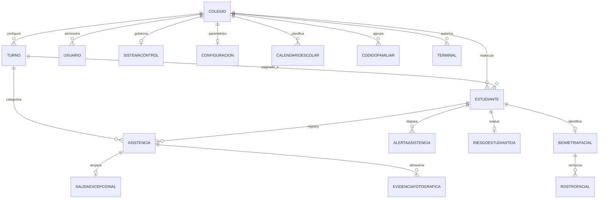
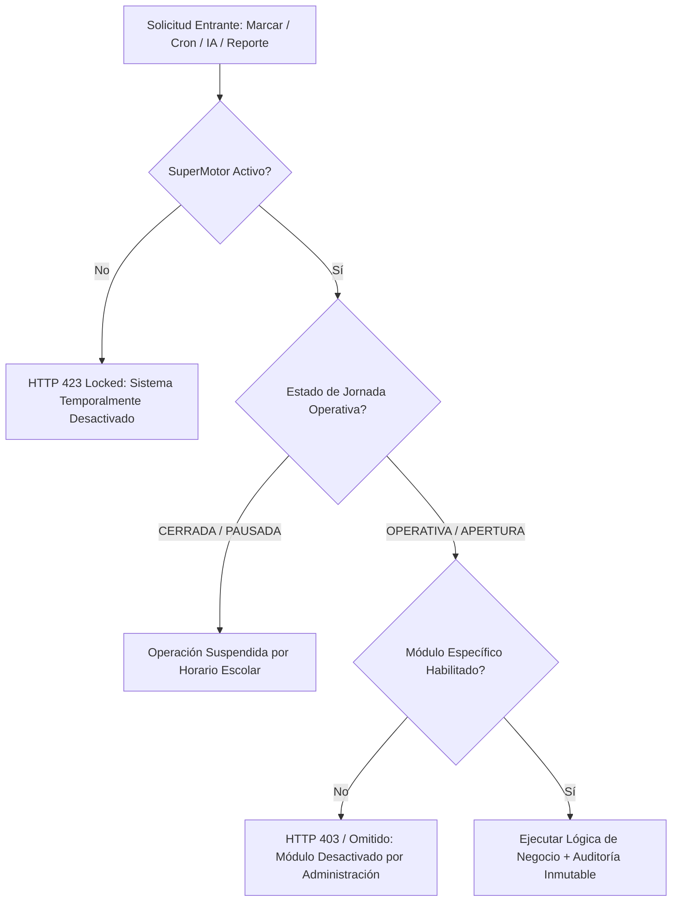

# FICHA TÉCNICA INTEGRAL DEL SISTEMA
## Sistema de Control de Asistencia Escolar Inteligente Multi-Colegio SaaS
**Versión de Producción:** 1.0 (Release Candidate / Go-Live)  
**Clasificación de Software:** Plataforma Web Progresiva (PWA) SaaS Multi-Tenant Cloud-Native  
**Zona Horaria Operativa:** `America/Lima` (UTC-05:00) — Sincronización horaria estricta Perú  
**Institución Principal de Referencia:** I.E.P. Santa Rita de Casia (`SANTA_RITA_001`)  
**Fecha de Publicación:** Septiembre de 2026  

---

## 1. RESUMEN EJECUTIVO Y PROPÓSITO GENERAL

El **Sistema de Control de Asistencia Escolar Inteligente** es una solución tecnológica integral de alta disponibilidad diseñada para transformar, automatizar y blindar la gestión de asistencia, puntualidad, retiros excepcionales y deserción escolar en instituciones educativas públicas y privadas.

La plataforma opera bajo un modelo **SaaS Multi-Colegio (Multi-Tenant)** con aislamiento criptográfico de datos, permitiendo a múltiples colegios operar de manera completamente independiente o bajo una administración centralizada. Combina capacidades de **reconocimiento biométrico facial por inteligencia artificial (AWS Rekognition)**, **escaneo de credenciales QR de alta velocidad**, **teclado numérico/código de barras DNI**, **despacho omnicanal en tiempo real (WhatsApp Business y Telegram Bot)**, **Server-Sent Events (SSE)** para streaming de eventos en vivo, y un motor cognitivo basado en **LLaMA (Groq SDK)** para predicción y detección preventiva de estudiantes en riesgo de deserción o abandono escolar.

---

## 2. FICHA TÉCNICA DEL STACK TECNOLÓGICO

```
┌────────────────────────────────────────────────────────────────────────┐
│                        ARQUITECTURA DEL SISTEMA                        │
├────────────────────────────────────────────────────────────────────────┤
│  CAPA CLIENTE / UI                                                     │
│  ├── Next.js 16.2.9 (App Router, Server & Client Components)           │
│  ├── React 19.2.4 & TypeScript 5.x                                     │
│  ├── Tailwind CSS v4 & Lucide / React Icons                            │
│  ├── Three.js 0.185 (WebGL Escudo 3D interactivo y Portal Transición)  │
│  ├── Recharts 3.9 (Visualización de analítica, curvas y tendencias)   │
│  └── HTML5 QR Code & Webcam Capture (Captura fotográfica y óptica)     │
├────────────────────────────────────────────────────────────────────────┤
│  CAPA DE NEGOCIO / SERVERLESS BACKEND                                  │
│  ├── Node.js Serverless Functions (Vercel Edge & Lambdas)              │
│  ├── SuperMotor Central Escolar (State Machine de jornada & guards)    │
│  ├── Clasificador Horario Unificado (Evaluador cronológico de Perú)    │
│  ├── EventBus Interno & Server-Sent Events (SSE) en tiempo real        │
│  └── Vercel Cron Jobs (Automatizaciones periódicas de ausentismo)      │
├────────────────────────────────────────────────────────────────────────┤
│  SERVICIOS EXTERNOS & IA                                               │
│  ├── Groq SDK / LLaMA (IA predictiva de deserción & redacción)         │
│  ├── AWS Rekognition v3 (Biometría facial con Face Collections)        │
│  ├── Vercel Blob Storage (Almacenamiento CDN de evidencias y fotos)    │
│  ├── Telegram Bot API (Notificaciones de Dirección, PDF y Excel)       │
│  └── WhatsApp Business API (Mensajería instantánea a apoderados)       │
├────────────────────────────────────────────────────────────────────────┤
│  PERSISTENCIA & SEGURIDAD                                              │
│  ├── PostgreSQL en Neon Cloud (Connection Pooling SSL)                 │
│  ├── Prisma ORM 7.8.0 (17 modelos relacionales)                       │
│  ├── Jose 6.2 (JWT HS256, Cookies HttpOnly seguras anti-XSS)           │
│  └── SHA-256 Hardware Token Kiosk Guard (Terminales de portería)       │
└────────────────────────────────────────────────────────────────────────┘
```

### Tabla de Especificaciones Técnicas

| Componente | Tecnología / Librería | Versión | Rol en el Sistema |
| :--- | :--- | :---: | :--- |
| **Framework Base** | Next.js (App Router) | 16.2.9 | Enrutamiento híbrido (SSR, RSC, API Routes), Turbopack y compilación optimizada. |
| **Librería de Vista** | React | 19.2.4 | Renderizado reactivo de interfaces de usuario concurrentes. |
| **Lenguaje Tipado** | TypeScript | 5.x | Tipado estricto en el 100% de la base de código; 0 errores de compilación. |
| **Estilos & Diseño** | Tailwind CSS | 4.0 | Sistema de diseño de alto impacto visual, soporte Glassmorphism y temas responsivos. |
| **Gráficos 3D** | Three.js | 0.185.1 | Escudo institucional 3D animado con iluminación WebGL e inercia rotacional en el login. |
| **Persistencia ORM** | Prisma Client & CLI | 7.8.0 | Gestión de esquema declarativo, migraciones e integridad referencial estricta. |
| **Base de Datos** | PostgreSQL (Neon Cloud) | v16 | Base de datos relacional serverless con pooler de conexiones activas SSL. |
| **Almacenamiento Archivos** | Vercel Blob Storage | 2.6.1 | Almacenamiento seguro en la nube para fotos de evidencia tomadas en portería y logos. |
| **Inteligencia Artificial** | Groq SDK (LLaMA 3.1 8B / 3.3 70B) | 1.3.0 | Inferencia ultrarrápida (<500ms) para predicción de riesgo escolar y alertas personalizadas. |
| **Biometría Facial** | AWS SDK Client Rekognition | 3.1102.0 | Indexación de rostros de alumnos y búsqueda de similitud biométrica (>97%). |
| **Autenticación & Criptografía** | Jose & BCrypt.js | 6.2.3 / 3.0.3 | Tokens JWT encriptados (HS256) en cookies `HttpOnly`, hashing de claves y tokens. |
| **Eventos en Tiempo Real** | SSE (Server-Sent Events) | Nativo Node | Streaming continuo unidireccional de marcaciones en portería hacia los dashboards. |
| **Generación de Reportes** | jsPDF + AutoTable / SheetJS | 4.2.1 / 0.18.5 | Exportación de fichas de asistencia en PDF membretados y sábanas de datos en Excel. |
| **Lectura de Credenciales** | HTML5-QRCode / QRCode | 2.3.8 / 1.5.4 | Generador e intérprete óptico de carnets escolares en dispositivos móviles y webcams. |
| **Tareas Programadas** | Vercel Cron & Route Handlers | Node.js | Cron Jobs protegidos para procesamiento de ausencias, cierre de jornada y reportes. |

---

## 3. ARQUITECTURA DE DATOS (17 TABLAS RELACIONALES)

El modelo de datos está normalizado en Prisma y desplegado sobre PostgreSQL, contando con índices B-Tree específicos y restricciones únicas compuestas para soportar alta concurrencia en portería.



### Detalle de Modelos y Funciones

1. **`Colegio`**: Entidad multi-tenant raíz. Almacena código institucional (`codigo`: ej. `SANTA_RITA_001`), razón social, teléfono, dirección, logo oficial y estado operativo (`ACTIVO`/`SUSPENDIDO`).
2. **`Estudiante`**: Ficha del alumno. Contiene DNI, código interno, nombres, apellidos, grado, sección, datos de contacto del tutor (WhatsApp, Telegram Chat ID), estado (activo/inactivo), turno asignado y vínculo a su `CodigoFamiliar`.
3. **`Turno`**: Jornadas escolares (Mañana, Tarde, Especial). Define hora de entrada, hora de salida, margen de entrada anticipada, tolerancia puntual inicial, margen de tardanza y tolerancia de salida.
4. **`Asistencia`**: Núcleo transaccional de marcaciones. Contiene hora de entrada, hora de salida, fecha en formato estándar Perú (`YYYY-MM-DD`), método (QR, DNI, FACIAL), estado de ingreso (`PUNTUAL`, `TARDE`, `JUSTIFICADO`), estado de jornada (`ABIERTA`, `CERRADA`), estado de salida (`PENDIENTE`, `REGISTRADA`, `EXCEPCIONAL`) y URLs de fotos de evidencia.  
   *Restricción de unicidad estricta:* `@@unique([estudianteId, fechaDia, turnoId])`.
5. **`SistemaControl`**: Panel de gobierno del SuperMotor por colegio. Contiene el interruptor maestro (`motorActivo`), conmutadores independientes de 8 módulos (`asistenciaActivo`, `portalActivo`, `telegramActivo`, `whatsappActivo`, `reportesActivo`, `iaActivo`, `alertasActivo`, `fotosActivo`), estado de jornada (`CERRADO`, `APERTURA`, `OPERATIVO`, `CIERRE`) y modo de operación (`MANUAL` o `AUTOMATICO`).
6. **`Configuracion`**: Parámetros de comunicación institucional. Canales habilitados, horarios de despacho de resúmenes diarios/semanales/mensuales, chat IDs del director y modo prueba de alertas.
7. **`CodigoFamiliar`**: Identificador alfanumérico seguro para el Portal de Padres. Agrupa a todos los hermanos de una misma familia bajo una única credencial para el apoderado.
8. **`Usuario`**: Cuentas del personal administrativo, directores y operadores del sistema con roles (`SUPER_ADMIN`, `ADMIN`, `DIRECTOR`, `PERSONAL`, `DEMO`) y claves con hash bcrypt.
9. **`Auditoria`**: Bitácora inmutable de trazabilidad de seguridad. Registra usuario, rol, acción, módulo, payload JSON y marcas de tiempo exactas para cada operación sensible.
10. **`AlertaAsistencia`**: Historial de alertas emitidas por inasistencias o tardanzas. Clave compuesta anti-duplicados `@@unique([estudianteId, fecha, tipo])` que garantiza idempotencia.
11. **`BiometriaFacial`**: Registro de vinculación con AWS Rekognition. Almacena `collectionId` y `externalImageId`.
12. **`RostroFacial`**: Descriptores y `faceId` vectorizados en AWS para reconocimiento facial en portería.
13. **`RiesgoEstudianteIA`**: Evaluación preventiva generada por LLaMA. Clasifica el nivel de deserción (`BAJO`, `MEDIO`, `ALTO`, `CRITICO`), resumen diagnóstico, recomendaciones y puntaje porcentual.
14. **`AnalisisIA`**: Almacenamiento histórico de consultas e inferencias emitidas por el módulo de inteligencia artificial.
15. **`CalendarioEscolar`**: Calendario oficial de días no lectivos, feriados nacionales, semanas de gestión docente y suspensiones de clases por turno o generales.
16. **`SalidaExcepcional`**: Registro formal de retiros prematuros durante la jornada (salud, accidente, cita médica, emergencia familiar) amparado en la asistencia del día.
17. **`EvidenciaFotografica`**: Trazabilidad del ciclo de vida de la foto de portería (`PENDIENTE`, `SUBIENDO`, `COMPLETADA`, `ERROR`, `ERROR_FINAL`), reintentos y URL en Vercel Blob.
18. **`SystemHealthLog`**: Registro de telemetría y salud de servicios en la nube (`DATABASE`, `SUPERMOTOR`, `CRON`, `TELEGRAM`, `WHATSAPP`, `STORAGE`).
19. **`Terminal`**: Registro de dispositivos kiosco autorizados (tablets, laptops de garita) autenticados mediante tokens SHA-256.

---

## 4. EL NÚCLEO OPERATIVO: "SUPERMOTOR ESCOLAR"

El **SuperMotor** (`lib/supermotor.ts` y `lib/supermotor-guard.ts`) es el cerebro que arbitra y protege la ejecución de todas las funciones del sistema.



### Capacidades del SuperMotor:
- **Kill-Switch General (`motorActivo = false`):** Detiene en menos de 50 milisegundos toda marcación en garita y suspende el procesamiento de crons sin reiniciar el servidor ni comprometer los datos.
- **Control de Fugas y Fallbacks:** Si un proveedor externo falla (ej. caída de WhatsApp o Telegram), el SuperMotor aísla el error, permitiendo que la marcación del alumno se complete exitosamente sin demoras.
- **Gestión Automática de Jornada:**
  - `APERTURA`: Conmuta antes del ingreso del primer turno; habilita terminales de portería.
  - `OPERATIVO`: Jornada regular de clases; monitoreo continuo.
  - `CIERRE`: Periodo post-salida; disparo de consolidación de inasistencias y reportes.
  - `CERRADO`: Bloqueo preventivo de marcaciones nocturnas.

---

## 5. MOTOR DE CLASIFICACIÓN DE ASISTENCIA Y REGLAS HORARIAS

El sistema incorpora un motor determinista en [`lib/clasificadorAsistencia.ts`](file:///c:/Users/Ingeniero%20de%20Sistema/Documents/Proyectos/sistema-asistencia/lib/clasificadorAsistencia.ts) que unifica la lógica en el Dashboard, el Portal de Padres, el Portal Público y las Automatizaciones.

### Estados Operativos del Estudiante

```
[HORA LIMA] ───► Antes de entrada ──► Tolerancia Inicial ──► Tolerancia Tardanza ──► Fin del Turno
                  (PENDIENTE_INICIO)    (ESPERANDO_INGRESO)   (INGRESO_PENDIENTE)   (AUSENTE_CONFIRMADO)
```

1. **Marcación Registrada:**
   - **`PUNTUAL`**: Marcó antes de la hora de entrada o dentro del margen de tolerancia inicial (`minutosAlertaInicial`, por defecto 5 a 10 min).
   - **`TARDE`**: Marcó después del margen de tolerancia y dentro del límite máximo de tardanza (`margenAlertaMinutos`, por defecto 15 a 30 min).
   - **`JUSTIFICADO`**: Registrado administrativamente por motivos de fuerza mayor.
2. **Evaluación Cronológica de Alumnos Sin Marcación:**
   - **`PENDIENTE_INICIO`**: La hora actual es previa a la hora de entrada programada para su turno.
   - **`ESPERANDO_INGRESO`**: Ventana de tolerancia inicial abierta; el alumno está dentro del tiempo habitual de llegada.
   - **`INGRESO_PENDIENTE`**: Superó la tolerancia inicial; se encuentra en ventana de tardanza pero aún puede ingresar.
   - **`TARDANZA_SIN_INGRESO`**: Se superó el margen de tardanza pero la jornada sigue en curso.
   - **`AUSENTE_CONFIRMADO`**: El turno escolar concluyó formalmente sin que el alumno haya registrado entrada.
   - **`TURNO_INACTIVO`**: El alumno pertenece a un turno no operativo; no contamina estadísticas de ausentismo.
   - **`NO_LECTIVO`**: Feriado o suspensión oficial programada en el Calendario Escolar.

---

## 6. MÓDULOS DEL SISTEMA Y FLUJOS FUNCIONALES

### Módulo 1: Terminal de Marcación Rápida (`/marcar`)
- **Interfaz Kiosk Mode:** Diseñada para pantallas táctiles de portería, tablets o computadoras con webcam o lectores de código de barras.
- **Métodos Simultáneos:**
  - **Lector de Código QR:** Lectura instantánea de carnets escolares mediante cámara.
  - **Teclado Numérico de DNI:** Ingreso manual rápido de 8 dígitos con validación instantánea.
  - **Reconocimiento Facial Biométrico:** Captura en vivo y cotejo en AWS Rekognition con umbral de coincidencia del 97%.
- **Evidencia Fotográfica Instantánea:** Cada marcación (entrada o salida) captura opcionalmente una fotografía que se sube en segundo plano a Vercel Blob Storage.
- **Audio y Feedback Visual Inmersivo:** Sonidos sintetizados de confirmación de ingreso/salida y alertas sonoras de advertencia (tardanza o fuera de horario).
- **Protección Anti-Doble Escaneo:** Bloqueo inteligente de 3 minutos para evitar que un alumno pase dos veces su carnet por accidente.

### Módulo 2: Panel de Control Ejecutivo (`/dashboard`)
- **Métricas en Tiempo Real:** Total matriculados, alumnos puntuales, tardanzas, justificados, ausentes confirmados y tasa de efectividad del día.
- **Transmisión en Vivo (SSE):** Cada alumno que marca en portería aparece inmediatamente en la tabla del dashboard sin requerir refresco de página.
- **Filtrado Avanzado:** Selector de fecha histórica, filtrado por turno, grado, sección y estado.
- **Analítica Visual:** Gráficos de barra y dona con distribución porcentual de asistencia.

### Módulo 3: Portal Web para Familias (`/portal-padres`)
- **Acceso Familiar Seguro:** Los apoderados acceden utilizando un **Código Familiar Único** (ej. `FAM-84920`).
- **Vista Multihijo:** Si una familia tiene 2 o más hijos en el colegio, el apoderado visualiza a todos en un solo panel consolidado.
- **Trazabilidad Completa:** Hora exacta de marcación de entrada, hora de salida, método utilizado, estado de puntualidad y fotografía de evidencia en portería para máxima tranquilidad parental.
- **Seguridad Anti-IDOR:** Aislamiento criptográfico estricto; un padre no puede acceder bajo ninguna circunstancia a los registros de otra familia.

### Módulo 4: Salidas Excepcionales y Retiros Anticipados (`/dashboard/salidas`)
- **Gestión de Contingencias:** Permite autorizar el retiro de un alumno durante el horario de clases.
- **Motivos Tipificados:**
  - `PROBLEMA_SALUD` / `ACCIDENTE_ESCOLAR` (Enfermería / Tópico)
  - `CITA_MEDICA`
  - `EMERGENCIA_FAMILIAR`
  - `RETIRO_AUTORIZADO` (Padre o apoderado presente en garita)
  - `OTRO` (con especificación obligatoria)
- **Cierre Seguro de Asistencia:** Actualiza atómicamente el estado de la asistencia del día a salida excepcional, registrando al usuario administrativo responsable y emitiendo el evento en tiempo real.

### Módulo 5: Inteligencia Artificial y Prevención de Deserción (`/dashboard/inteligencia`)
- **Motor Cognitivo con LLaMA (Groq SDK):** Analiza el historial acumulado de asistencias, tardanzas consecutivas y patrones de inasistencias.
- **Semáforo de Riesgo:**
  - 🟢 **BAJO:** Alumno regular con puntualidad > 90%.
  - 🟡 **MEDIO:** Tardanzas recurrentes o inasistencias esporádicas.
  - 🟠 **ALTO:** 3 o más inasistencias en un periodo corto.
  - 🔴 **CRÍTICO:** Patrón claro de abandono escolar inminente.
- **Recomendaciones Pedagógicas Personalizadas:** Generación instantánea de sugerencias para tutores y psicólogos del colegio, así como redacción de mensajes empáticos de seguimiento para padres de familia.

### Módulo 6: Notificaciones Omnicanal (WhatsApp y Telegram)
- **WhatsApp:** Notificación automática al número del apoderado en cuanto el alumno registra entrada o salida en portería.
- **Telegram:** Canal oficial para la Dirección y Coordinación General:
  - Alertas instantáneas de incidentes.
  - Envío automático de resúmenes diarios, semanales y mensuales en formato **PDF oficial membretado** y **Excel consolidado**.

### Módulo 7: Motor de Automatizaciones (Cron Jobs)
- **Ruta Servidora:** `/api/cron/automatizaciones`.
- **Protección Criptográfica:** Autenticación por Bearer Token mediante variable de entorno `CRON_SECRET`.
- **Tareas Automatizadas:**
  1. Monitoreo y detección de ausencias al concluir los horarios de entrada.
  2. Despacho de alertas masivas programadas.
  3. Generación y envío de reportes periódicos al Director.
  4. Generación y envío de reportes de seguimiento a padres.
  5. Cierre automático de jornada escolar al término del día.

### Módulo 8: Centro de Respaldo y Restauración (`/dashboard/backup`)
- **Copia de Seguridad Integral:** Exportación en un clic de las **17 tablas relacionales** de la base de datos en formato JSON estructurado.
- **Restauración Segura:** Capacidad de reimportar y rehidratar la información en caso de contingencia o migración de infraestructura.

### Módulo 9: Observabilidad y Salud del Sistema (`/api/health`)
- **Telemetría Continua:** Health checks periódicos que monitorean la latencia de respuesta de la base de datos PostgreSQL en Neon, la disponibilidad de Vercel Blob, el estado de los canales de mensajería y el consumo de memoria.

---

## 7. MATRIZ DE SEGURIDAD Y CONTROL DE ACCESO (RBAC)

El sistema implementa un esquema de Control de Acceso Basado en Roles (RBAC) con 8 niveles de autorización:

| Rol | Alcance | Permisos Principales |
| :--- | :--- | :--- |
| **`SUPER_ADMIN`** | Multi-Colegio Global | Gestión de todos los colegios de la red, aprovisionamiento de tenants, configuraciones maestras de infraestructura y acceso irrestricto. |
| **`ADMIN`** | Colegio Específico | Administración total de la institución: control del SuperMotor, altas/bajas de personal y alumnos, configuración de turnos, backups y auditoría. |
| **`ADMIN_COLEGIO`** | Colegio Específico | Administración institucional delegada y configuración de calendarios. |
| **`DIRECTIVO` / `DIRECTOR`** | Colegio Específico | Acceso a dashboards gerenciales, reportes de inteligencia artificial, sábanas de asistencia en PDF/Excel y auditoría de asistencia. |
| **`PERSONAL`** | Portería / Garita | Operación del módulo de marcación rápida (`/marcar`), registro de salidas excepcionales y consultas de alumnos. |
| **`DEMO`** | Colegio Específico | Acceso de solo lectura con fines de capacitación y demostración comercial (bloqueado para modificaciones críticas). |
| **`PADRE`** | Familiar (Anti-IDOR) | Acceso exclusivo a los datos de sus hijos a través del Portal de Familias mediante cookie `HttpOnly`. |

### Mecanismos de Seguridad Implementados:
- **Protección Anti-IDOR (Insecure Direct Object References):** Cada consulta en el portal de padres o en las APIs de asistencia valida que los recursos pertenezcan estrictamente al `colegioId` y al `codigoFamiliarId` del usuario autenticado.
- **Prevención de Ataques de Temporización (Timing Attacks):** Validación de tokens de hardware mediante `crypto.timingSafeEqual`.
- **Cookies Seguras:** Tokens de sesión firmados con clave criptográfica de 256 bits, configurados con directivas `HttpOnly`, `SameSite=Lax` y `Secure` en producción.
- **Sanitización de URLs y Evidencias:** Bloqueo de URLs ficticias o locales para garantizar que solo imágenes legítimas alojadas en Vercel Blob sean enlazadas.

---

## 8. REQUISITOS DEL SISTEMA Y DESPLIEGUE

### Entorno de Servidor (Producción Cloud):
- **Hosting / Cómputo:** Vercel Pro (Serverless Functions Node.js runtime).
- **Base de Datos:** PostgreSQL 15+ en Neon Database con Connection Pooler (PgBouncer) activo.
- **Almacenamiento CDN:** Vercel Blob Storage.
- **Servicios de Terceros:** AWS IAM con permisos en Amazon Rekognition, Groq API Key para inferencia LLaMA, Telegram Bot Token y Meta / WhatsApp Business Cloud API.

### Hardware Recomendado en Garita / Portería Escolar:
- **Dispositivo Kiosco:** PC todo-en-uno, laptop o tablet con pantalla táctil (resolución mínima recomendada 1280x720).
- **Cámara:** Webcam HD (1080p recomendada para biometría facial y nitidez de evidencia).
- **Lector Óptico:** Lector de código de barras / código QR 2D USB o Bluetooth (opcional, opera como emulador de teclado a alta velocidad).
- **Conectividad:** Conexión a Internet estable (mínimo 5 Mbps de subida y bajada).
- **Navegador Web:** Google Chrome, Microsoft Edge o Safari actualizados.

---

## 9. CICLO OPERATIVO DIARIO (WORKFLOW INSTITUCIONAL)

```
06:00 AM ──► Apertura automática de jornada por el SuperMotor
06:30 AM ──► Activación de terminales kiosco en garita escolar
07:00 AM ──► Inicio de escaneo masivo (QR / DNI / Facial) en portería
             ├── Validación de turno y horario vigente
             ├── Fotografía de evidencia en Vercel Blob
             ├── Transmisión en vivo al Dashboard vía SSE
             └── Despacho de WhatsApp al apoderado en segundo plano
08:15 AM ──► Conclusión de tolerancia; marcaciones clasificadas como TARDANZA
09:00 AM ──► Ejecución del Cron Job de detección de alumnos con ausentismo
             └── Alerta preventiva al tutor y dirección
10:00 AM ──► Ventana de atención de salidas excepcionales (tópico / emergencias)
01:30 PM ──► Inicio de marcación de salida escolar de los estudiantes
03:00 PM ──► Consolidación y cierre de jornada del turno diurno
06:00 PM ──► Despacho del reporte diario consolidado en PDF y Excel al Director
09:00 PM ──► Cierre nocturno de jornada y bloqueo preventivo del SuperMotor
```

---

## 10. RESUMEN DE ARCHIVOS CLAVE DE LA ARQUITECTURA

- **Gobernanza y Guards:** [`lib/supermotor.ts`](file:///c:/Users/Ingeniero%20de%20Sistema/Documents/Proyectos/sistema-asistencia/lib/supermotor.ts) y [`lib/supermotor-guard.ts`](file:///c:/Users/Ingeniero%20de%20Sistema/Documents/Proyectos/sistema-asistencia/lib/supermotor-guard.ts)
- **Lógica de Horarios y Tolerancias:** [`lib/clasificadorAsistencia.ts`](file:///c:/Users/Ingeniero%20de%20Sistema/Documents/Proyectos/sistema-asistencia/lib/clasificadorAsistencia.ts) y [`lib/timezone.ts`](file:///c:/Users/Ingeniero%20de%20Sistema/Documents/Proyectos/sistema-asistencia/lib/timezone.ts)
- **Núcleo de Asistencias:** [`app/api/asistencias/route.ts`](file:///c:/Users/Ingeniero%20de%20Sistema/Documents/Proyectos/sistema-asistencia/app/api/asistencias/route.ts)
- **Terminal de Marcación:** [`app/marcar/page.tsx`](file:///c:/Users/Ingeniero%20de%20Sistema/Documents/Proyectos/sistema-asistencia/app/marcar/page.tsx)
- **Portal de Padres:** [`app/portal-padres/page.tsx`](file:///c:/Users/Ingeniero%20de%20Sistema/Documents/Proyectos/sistema-asistencia/app/portal-padres/page.tsx)
- **Modelo de Base de Datos:** [`prisma/schema.prisma`](file:///c:/Users/Ingeniero%20de%20Sistema/Documents/Proyectos/sistema-asistencia/prisma/schema.prisma)
- **Cron y Automatizaciones:** [`app/api/cron/automatizaciones/route.ts`](file:///c:/Users/Ingeniero%20de%20Sistema/Documents/Proyectos/sistema-asistencia/app/api/cron/automatizaciones/route.ts)
- **Auditoría de Liberación Go-Live:** [`AUDITORIA_FINAL_GO_LIVE_V1.md`](file:///c:/Users/Ingeniero%20de%20Sistema/Documents/Proyectos/sistema-asistencia/AUDITORIA_FINAL_GO_LIVE_V1.md)
