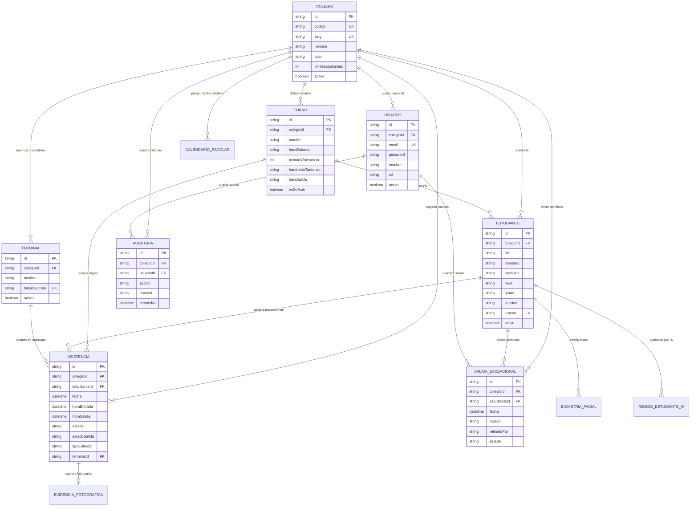

# DOCUMENTO 05: AUDITOR�A DE BASE DE DATOS Y MODELO DE DATOS

**Proyecto:** Sistema de Gesti�n de Asistencia Escolar Multi-Colegio SaaS  
**Motor de Base de Datos:** PostgreSQL en la nube (Neon Serverless PostgreSQL)  
**ORM:** Prisma ORM v7.8  
**Total de Entidades:** 20 Modelos Relacionales  
**Auditor Responsable:** Especialista en Arquitectura de Bases de Datos y Optimizaci�n SQL  

---

## 1. Resumen de la Estructura de Persistencia

La persistencia del sistema est� modelada mediante Prisma ORM sobre una base de datos relacional PostgreSQL hospedada en Neon. El dise�o implementa un modelo **Multi-Tenant L�gico mediante Discriminador por Columna** (`colegioId`), compartiendo el mismo esquema f�sico y tablas entre todos los colegios suscritos.

---

## 2. Inventario Detallado de las 20 Entidades Relacionales

### 1. Modelo `Colegio` (Tenant Ra�z)
- **Prop�sito:** Entidad organizativa central. Representa cada instituci�n educativa suscriptora del servicio SaaS.
- **Campos Principales:**
  - `id` (String, PK, CUID / UUID): Identificador �nico del colegio.
  - `nombre` (String): Raz�n social o nombre visible de la instituci�n.
  - `codigo` (String, Unique): Identificador institucional corto (ej. `SANTA_RITA_001`).
  - `slug` (String, Unique): Identificador alfanum�rico para subdominios o rutas web.
  - `plan` (Enum / String, Default: "PRO"): Nivel de suscripci�n (`BASIC`, `PRO`, `ENTERPRISE`).
  - `limiteEstudiantes` (Int, Default: 500): Cuota m�xima de estudiantes permitida.
  - `activo` (Boolean, Default: true): Estado operativo de la suscripci�n.
  - `createdAt`, `updatedAt` (DateTime): Marcas de tiempo de auditor�a.
- **Relaciones (1 a N):** Tiene m�ltiples `Estudiante`, `Turno`, `Usuario`, `Asistencia`, `Configuracion`, `Auditoria`, `CalendarioEscolar`, `Terminal`, `SalidaExcepcional`.
- **�ndices:** `@unique` en `codigo`, `@unique` en `slug`.

### 2. Modelo `Estudiante` (Padr�n Escolar)
- **Prop�sito:** Almacena la identidad y datos escolares de cada estudiante matriculado.
- **Campos Principales:**
  - `id` (String, PK, CUID): Identificador �nico interno.
  - `colegioId` (String, FK): Llave for�nea hacia `Colegio.id`.
  - `dni` (String): Documento Nacional de Identidad del alumno (8 d�gitos num�ricos).
  - `codigoEstudiante` (String, Nullable): C�digo de matr�cula interno del colegio.
  - `nombres` (String), `apellidos` (String): Identidad formal del estudiante.
  - `nivel` (String): Nivel formativo ("INICIAL", "PRIMARIA", "SECUNDARIA").
  - `grado` (String), `seccion` (String): Identificadores en texto libre del aula (ej. "3ro", "B").
  - `turnoId` (String, FK, Nullable): Llave for�nea hacia `Turno.id`.
  - `fotoUrl` (String, Nullable): URL o ruta de la foto de perfil del carnet.
  - `activo` (Boolean, Default: true): Estado de matr�cula activa o retirado.
- **Relaciones:** Pertenece a `Colegio` y `Turno`. Tiene m�ltiples `Asistencia`, `SalidaExcepcional`, `BiometriaFacial`, `RiesgoEstudianteIA`.
- **Restricciones e �ndices:** `@@unique([colegioId, dni])`, `@@index([colegioId, grado, seccion])`.

### 3. Modelo `Turno` (Horarios Institucionales)
- **Prop�sito:** Define las franjas horarias y reglas de tolerancia para el c�lculo de puntualidad.
- **Campos Principales:**
  - `id` (String, PK, CUID): Identificador �nico del turno.
  - `colegioId` (String, FK): Llave for�nea hacia `Colegio.id`.
  - `nombre` (String): Nombre del turno (ej. "Turno Ma�ana Regular", "Inicial Tarde").
  - `horaEntrada` (String): Hora l�mite de ingreso puntual en formato `HH:mm` (ej. "07:45").
  - `minutosTolerancia` (Int, Default: 10): Minutos de gracia tras la hora de entrada.
  - `horaInicioTardanza` (String): Hora a partir de la cual se considera tardanza severa (ej. "08:15").
  - `horaSalida` (String): Hora oficial de salida escolar (ej. "14:00").
  - `esDefault` (Boolean, Default: false): Turno asignado autom�ticamente a nuevos alumnos.
- **Relaciones:** Pertenece a `Colegio`. Vinculado a m�ltiples `Estudiante` y `Asistencia`.

### 4. Modelo `Asistencia` (Transacciones de Marcaci�n Diaria)
- **Prop�sito:** Registro diario de entradas, salidas, puntualidad y faltas por estudiante.
- **Campos Principales:**
  - `id` (String, PK, CUID): Identificador �nico de la marcaci�n.
  - `colegioId` (String, FK): Llave for�nea hacia `Colegio.id`.
  - `estudianteId` (String, FK): Llave for�nea hacia `Estudiante.id`.
  - `fecha` (DateTime): Fecha normalizada del d�a escolar (medianoche UTC o local).
  - `horaEntrada` (DateTime, Nullable): Timestamp exacto de la marcaci�n de ingreso.
  - `horaSalida` (DateTime, Nullable): Timestamp exacto de la marcaci�n de egreso.
  - `estado` (String): Clasificaci�n del ingreso (`PUNTUAL`, `TARDE`, `TARDE_SEVERA`, `FALTA`).
  - `estadoSalida` (String, Nullable): Clasificaci�n del egreso (`SALIDA_REGULAR`, `SALIDA_ANTICIPADA`, `SALIDA_JUSTIFICADA`).
  - `tipoEntrada` (String, Default: "KIOSCO_QR"): Medio de registro (`KIOSCO_QR`, `FACIAL`, `MANUAL`, `SISTEMA_CRON`).
  - `terminalId` (String, FK, Nullable): Llave for�nea hacia `Terminal.id`.
- **Relaciones:** Pertenece a `Colegio`, `Estudiante` y opcionalmente a `Terminal`.
- **Restricciones e �ndices:** `@@unique([colegioId, estudianteId, fecha])`, `@@index([colegioId, fecha, estado])`.

### 5. Modelo `Usuario` (Personal Administrativo del Sistema)
- **Prop�sito:** Cuentas con credenciales para acceder al panel de administraci�n institucional.
- **Campos Principales:**
  - `id` (String, PK, CUID): Identificador �nico.
  - `colegioId` (String, FK): Llave for�nea hacia `Colegio.id`.
  - `email` (String, Unique): Correo electr�nico institucional.
  - `password` (String): Hash criptogr�fico de contrase�a (bcrypt).
  - `nombre` (String): Nombre completo del funcionario.
  - `rol` (Enum: `SUPERADMIN`, `ADMIN_COLEGIO`, `DIRECTOR`, `COORDINADOR`, `RECEPCION`).
  - `activo` (Boolean, Default: true): Estado de habilitaci�n.

### 6. Modelo `Configuracion` (Par�metros Institucionales)
- **Prop�sito:** Almacena par�metros globales de la instituci�n educativa en pares clave-valor o campos estructurados.
- **Campos Principales:** `id`, `colegioId`, `zonaHoraria` ("America/Lima"), `logoUrl`, `direccion`, `telefono`, `notificacionesActivas` (Boolean).

### 7. Modelo `Auditoria` (Bit�cora Inmutable de Trazabilidad)
- **Prop�sito:** Registro estricto de eventos sensibles, operaciones de creaci�n, edici�n y accesos.
- **Campos Principales:** `id`, `colegioId`, `usuarioId` (Nullable), `accion` (String), `entidad` (String), `registroId` (String), `detalles` (JSON/String), `ip` (String), `createdAt` (DateTime).
- **�ndices:** `@@index([colegioId, createdAt])`, `@@index([usuarioId])`.

### 8. Modelo `AlertaAsistencia` (Notificaciones a Familias)
- **Prop�sito:** Cola de mensajes generados para alertar a los apoderados sobre tardanzas o ausencias.
- **Campos Principales:** `id`, `colegioId`, `estudianteId`, `tipo` ("TARDANZA", "FALTA", "SALIDA"), `destinatario` (Tel�fono), `canal` ("WHATSAPP", "SMS"), `estado` ("PENDIENTE", "ENVIADO", "FALLIDO"), `intentoNumero` (Int).

### 9. Modelo `AnalisisIA` y 10. `RiesgoEstudianteIA` (Motor Predictivo)
- **Prop�sito:** Almacena diagn�sticos y scores de riesgo de deserci�n generados mediante el LLM de Groq.
- **Campos Principales:** `id`, `estudianteId`, `nivelRiesgo` ("BAJO", "MEDIO", "ALTO", "CRITICO"), `score` (Float), `factores` (JSON), `recomendaciones` (String), `fechaAnalisis` (DateTime).

### 11. Modelo `CalendarioEscolar` (D�as No Lectivos y Feriados)
- **Prop�sito:** Fechas en las cuales no se debe exigir asistencia ni registrar inasistencias por cron.
- **Campos Principales:** `id`, `colegioId`, `fecha` (DateTime), `descripcion` (String), `esFeriado` (Boolean, Default: true).
- **Restricci�n:** `@@unique([colegioId, fecha])`.

### 12. Modelo `HistorialReporteAutomatico`
- **Prop�sito:** Trazabilidad de reportes ejecutados y exportados peri�dicamente por el sistema.

### 13. Modelo `BiometriaFacial` y 14. `RostroFacial`
- **Prop�sito:** Metadatos y vectores biom�tricos asociados a AWS Rekognition.
- **Campos Principales:** `id`, `estudianteId`, `rekognitionFaceId` (String), `rekognitionImageId` (String), `confianza` (Float).

### 15. Modelo `CodigoFamiliar` / Acceso de Apoderados
- **Prop�sito:** Token secreto de 8 caracteres que permite el ingreso de apoderados a consultar a sus hijos sin credencial corporativa.
- **Campos Principales:** `id`, `colegioId`, `dniApoderado`, `codigoAcceso` (String, Unique/Indexed), `activo` (Boolean).

### 16. Modelo `SistemaControl` y 17. `SystemHealthLog`
- **Prop�sito:** Registros t�cnicos del estado del servidor, banderas de mantenimiento global y monitoreo de uptime/latencia.

### 18. Modelo `Terminal` (Dispositivos Autorizados de Garita)
- **Prop�sito:** Registro y autorizaci�n de hardware f�sico para el kiosco de marcaci�n en porter�a.
- **Campos Principales:** `id`, `colegioId`, `nombre` (ej. "Garita Principal"), `tokenSecreto` (String, Unique), `activo` (Boolean), `ultimaConexion` (DateTime).

### 19. Modelo `SalidaExcepcional` (Permisos de Retiro Anticipado)
- **Prop�sito:** Autorizaciones formales concedidas a un alumno para salir del colegio antes de la hora de fin de jornada.
- **Campos Principales:** `id`, `colegioId`, `estudianteId`, `fecha` (DateTime), `horaSalida` (String), `motivo` (String), `retiradoPor` (String), `dniRetirante` (String), `parentesco` (String), `autorizadoPorUsuarioId` (String, FK), `estado` ("AUTORIZADO", "UTILIZADO", "CANCELADO").

### 20. Modelo `EvidenciaFotografica` (Fotos de Auditor�a en Garita)
- **Prop�sito:** Almacenamiento de capturas fotogr�ficas tomadas en el momento exacto del escaneo en el kiosco para auditor�a visual anti-suplantaci�n.
- **Campos Principales:** `id`, `asistenciaId` (FK hacia Asistencia), `fotoUrl` (String), `timestamp` (DateTime).

---

## 3. Diagrama Entidad-Relaci�n (DER) en Mermaid

A continuaci�n se presenta el modelo relacional t�cnico del sistema:

---

## 4. An�lisis de Integridad Referencial y Restricciones

### 4.1 Unicidad y Prevenci�n de Duplicados
- **Estudiantes por Colegio:** La restricci�n `@@unique([colegioId, dni])` garantiza que ning�n estudiante pueda registrarse dos veces con el mismo DNI dentro de la misma instituci�n educativa.
- **Asistencia Diaria:** La restricci�n compuesta `@@unique([colegioId, estudianteId, fecha])` en la tabla `Asistencia` act�a como barrera f�sica contra doble inserci�n en la base de datos. Si dos kioscos intentan crear una entrada simult�nea para el mismo alumno en la misma fecha, el motor de PostgreSQL arroja una excepci�n de clave �nica (`Unique constraint failed`), preservando la integridad.

### 4.2 Pol�ticas de Cascada (`onDelete`)
- La mayor�a de las relaciones secundarias hacia `Colegio` tienen configurado `onDelete: Cascade`. Si un colegio fuese eliminado, todas sus asistencias, estudiantes y turnos se destruir�an en cascada.
- **Hallazgo Cr�tico:** La tabla `Auditoria` contiene clave for�nea referenciando a `Usuario`. Si un usuario administrativo es eliminado f�sicamente de la base de datos mediante `DELETE`, los registros de auditor�a asociados corren riesgo de violar la integridad referencial a menos que el campo `usuarioId` sea nullable (`SetNull`) o se emplee borrado l�gico (`activo: false`).

---

## 5. Riesgos Detectados de P�rdida o Inconsistencia de Datos

1. **Riesgo por Incompletitud en Backup (`/api/backup`):**  
   El volcado de base de datos actual omite las entidades `Terminal`, `SalidaExcepcional` y `EvidenciaFotografica`. Si un administrador restaura un backup, estas tablas quedan desincronizadas o hu�rfanas, perdi�ndose los justificativos de salidas y autorizaciones de hardware.
2. **Riesgo por Vaciado Global sin Tenant (`/api/desarrollador/reiniciar-sistema`):**  
   El script de reinicio invoca `prisma.estudiante.deleteMany()` sin especificar el `colegioId`. Un solo usuario con rol `ADMIN_COLEGIO` que active esta opci�n borrar� los estudiantes y asistencias de **TODOS los colegios de la base de datos**, provocando un desastre de p�rdida total de informaci�n multi-inquilino.
3. **Ausencia de Normalizaci�n en Aulas:**  
   Al no existir tablas `Grado` y `Seccion`, los errores tipogr�ficos en la importaci�n (ej. escribir "3ero A", "3� A", "3 A") crean "aulas virtuales" fragmentadas en los reportes y filtros del dashboard.
