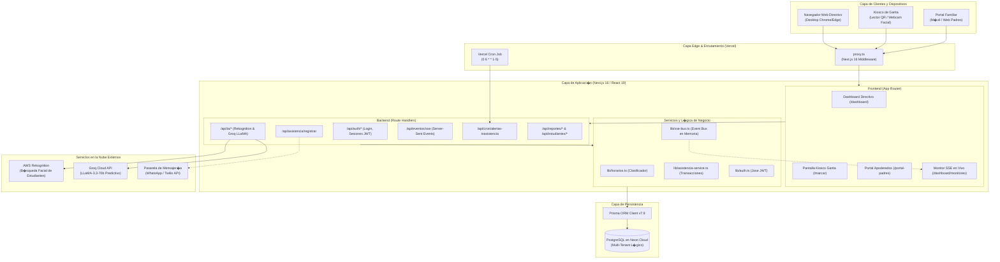
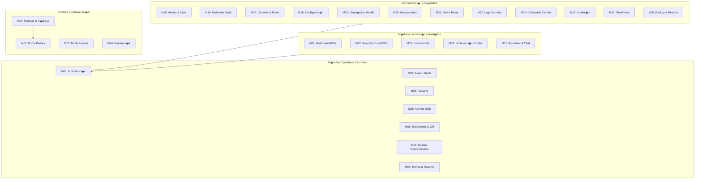
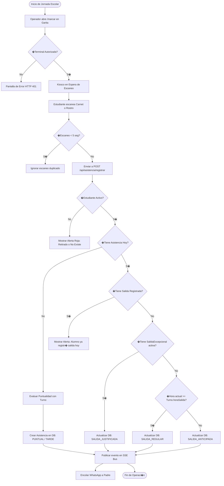
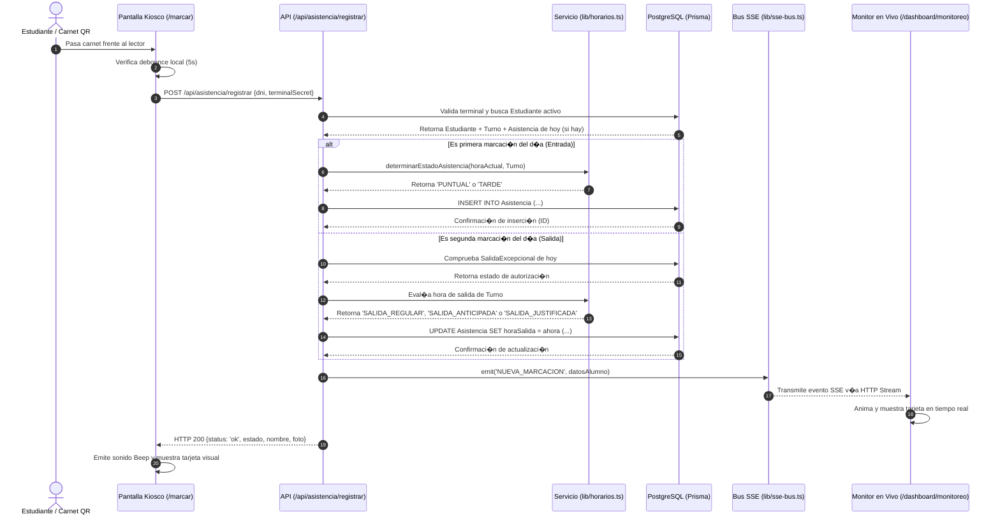
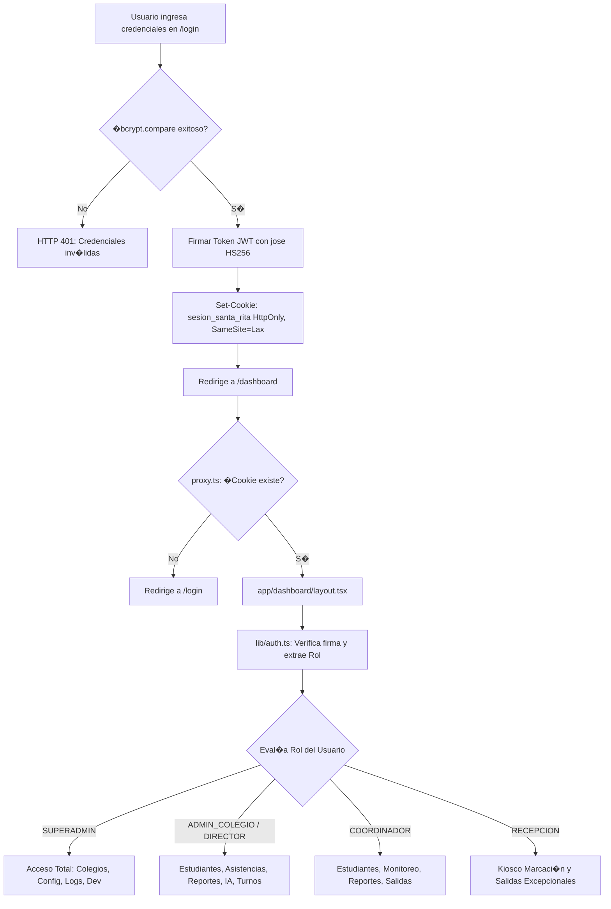
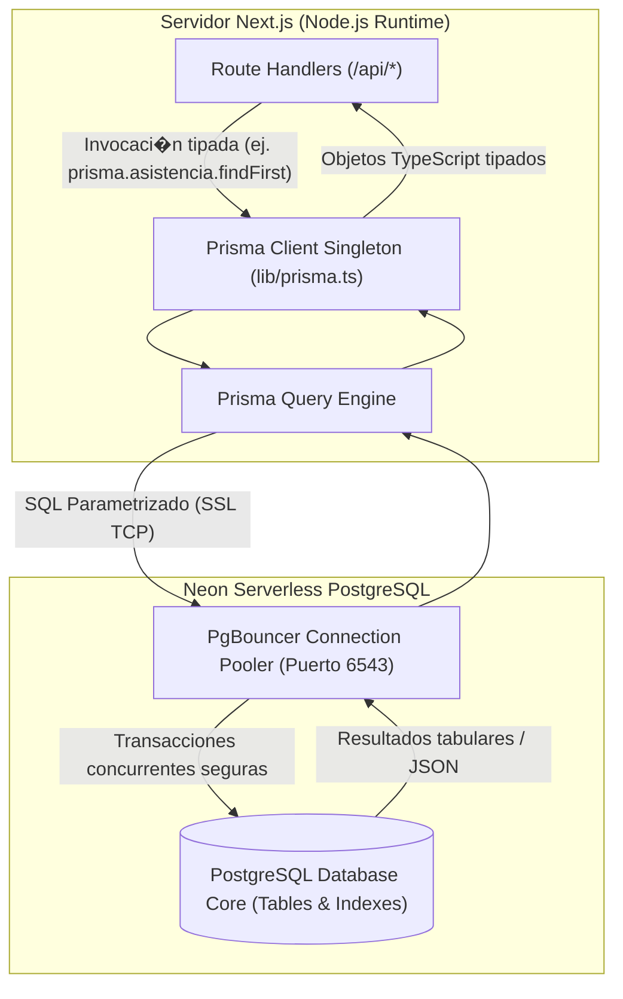
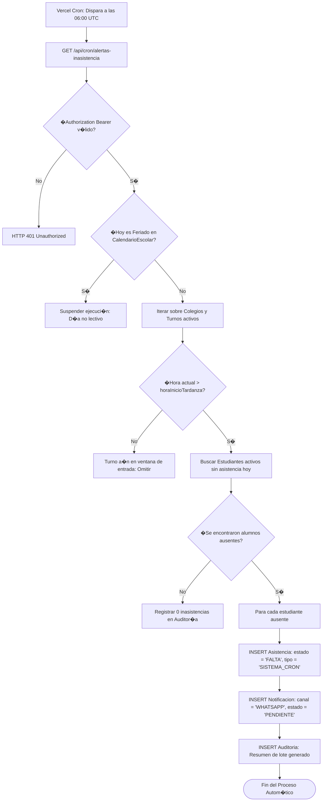
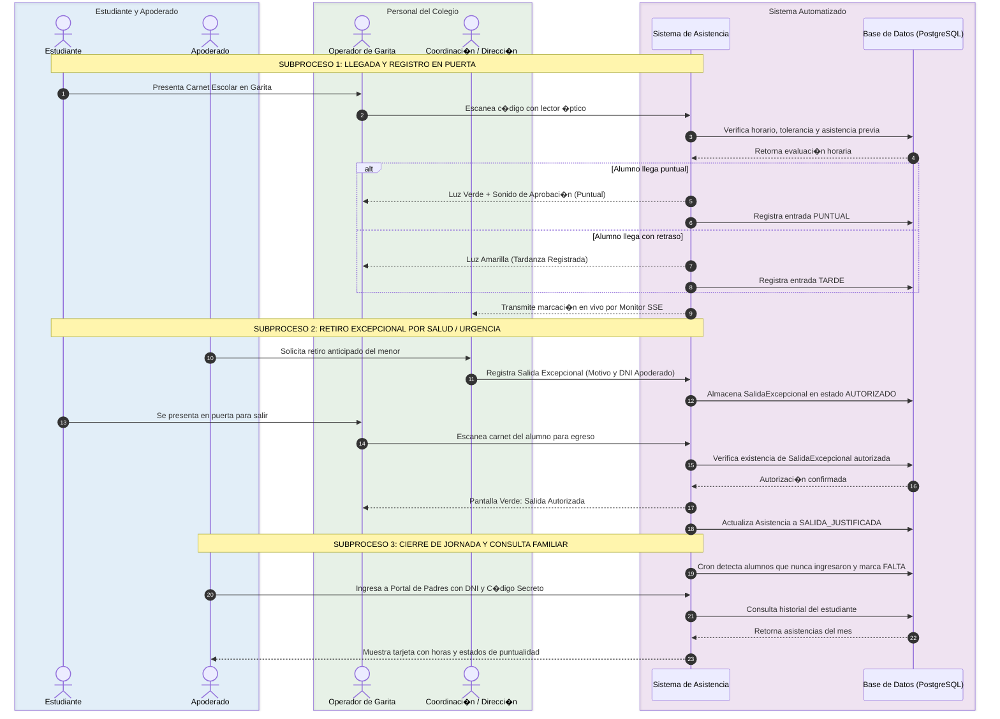

# DOCUMENTO 09: DIAGRAMAS T�CNICOS Y MODELADO DE PROCESOS (BPMN / MERMAID)

**Proyecto:** Sistema de Gesti�n de Asistencia Escolar Multi-Colegio SaaS  
**Est�ndar de Diagramaci�n:** Mermaid v10+ y Notaci�n de Modelado de Procesos BPMN  
**Auditor Responsable:** Arquitecto de Software y Analista Senior de Procesos  

---

## 1. Diagrama 1: Arquitectura General del Sistema

---

## 2. Diagrama 2: Mapa de M�dulos del Sistema

---

## 3. Diagrama 3: Flujo Completo de Funcionamiento

---

## 4. Diagrama 4: Flujo del Registro de Asistencia (Secuencia Detallada)

---

## 5. Diagrama 5: Flujo de Autenticaci�n y Autorizaci�n por Roles

---

## 6. Diagrama 6: Flujo de Comunicaci�n con la Base de Datos

---

## 7. Diagrama 7: Flujo del Cron Job y Detecci�n de Faltas

---

## 8. Diagrama 8: Flujo de Procesos Institucional Estilo BPMN / Bizagi

A continuaci�n se modela el proceso de negocio completo con carriles de responsabilidad (Swimlanes):

