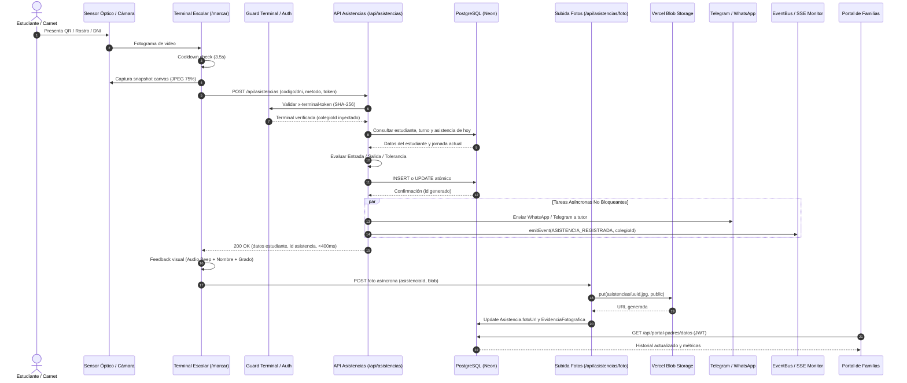
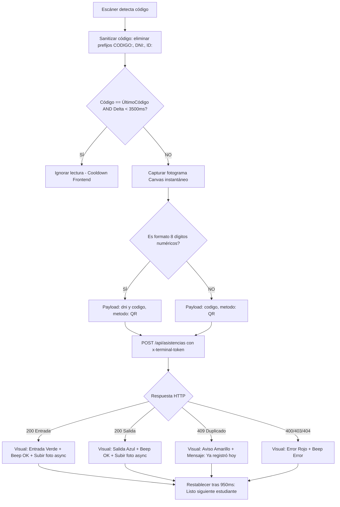
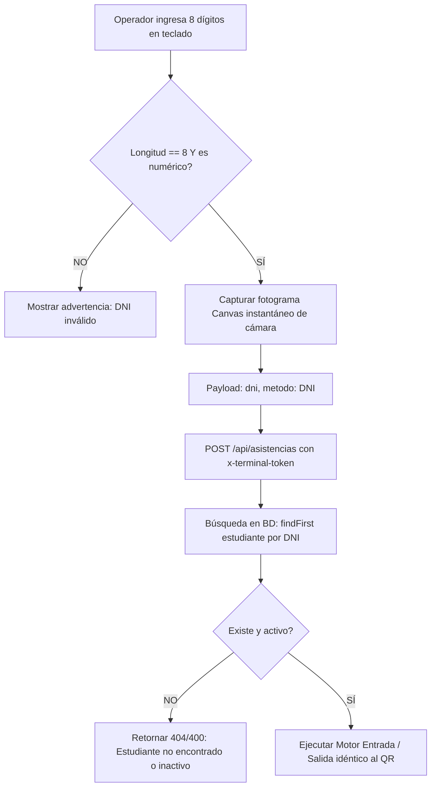
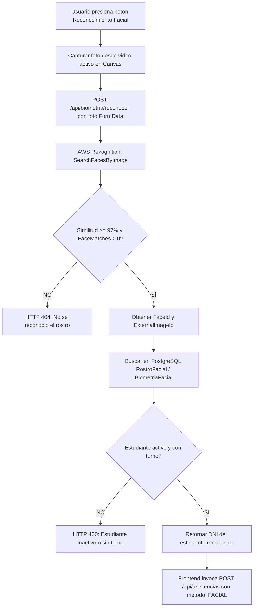
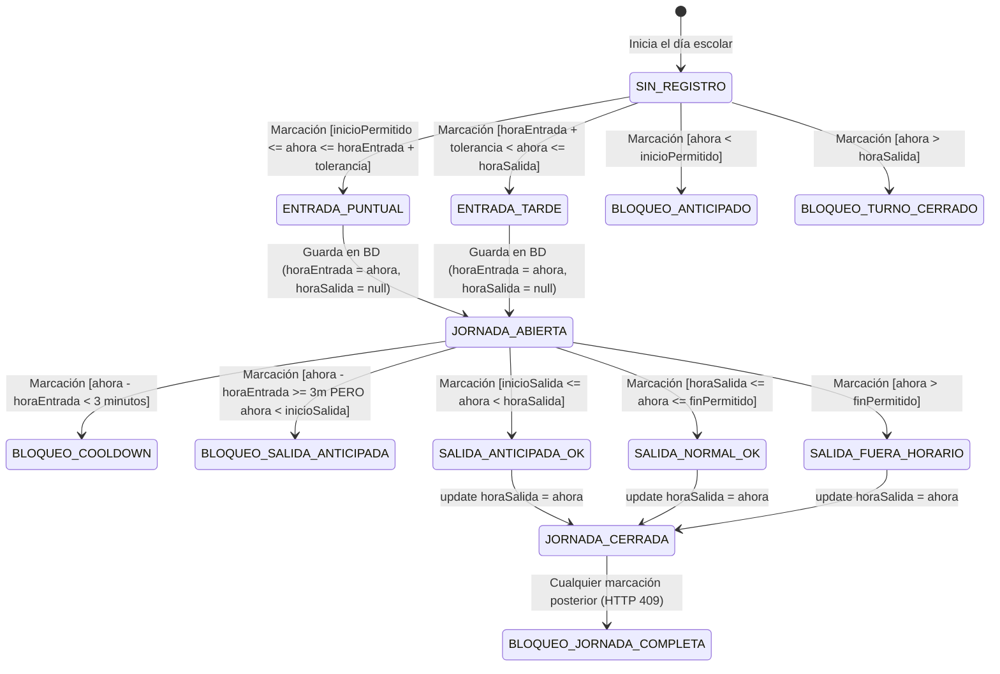

# 14. AUDITORÍA OPERATIVA END-TO-END DEL CORAZÓN DEL SISTEMA DE ASISTENCIA ESCOLAR

**Fecha de Ejecución:** 10 de Octubre de 2026  
**Auditor Responsable:** Arquitecto de Software Senior, QA Lead & Especialista en Seguridad Escolar  
**Entorno de Auditoría:** Simulación Aislada en Memoria (Zero Impact en Neon Producción)  
**Ramas Auditadas:** `feature/terminal-v2-camara-qr` (incorporando `fix/portal-padres-aislamiento` commit `05ef039`)  
**Estado General de la Auditoría:** **DIAGNÓSTICO COMPLETO — LISTO PARA REVISIÓN Y AUTORIZACIÓN**

---

## RESUMEN EJECUTIVO DE LA AUDITORÍA

Se ha completado una **Auditoría Operativa Integral de Caja Blanca y Caja Negra** sobre el núcleo transaccional del Sistema de Asistencia Escolar. La evaluación abarcó desde el sensor óptico en el navegador del cliente hasta la persistencia transaccional en PostgreSQL, los cron jobs automáticos de inasistencia, la distribución en tiempo real por SSE, y la entrega privada de información a las familias a través del Portal de Padres.

### Veredicto Global por Módulos

| Componente Auditado | Estado Dictaminado | Evidencia Técnica Clave |
| :--- | :---: | :--- |
| **Unificación de Canales (QR, DNI, Facial)** | **APROBADO CON PRUEBA** | Los 3 canales convergen en el mismo endpoint central [POST /api/asistencias](file:///c:/Users/Ingeniero%20de%20Sistema/Documents/Proyectos/sistema-asistencia/app/api/asistencias/route.ts#L330). Mismas reglas horarias y tolerancias. |
| **Seguridad de Terminales (Hardware Token)** | **APROBADO CON PRUEBA** | Tokens SHA-256 en cabeceras `x-terminal-id` y `x-terminal-token` con comparación en tiempo constante ([timingSafeEqual](file:///c:/Users/Ingeniero%20de%20Sistema/Documents/Proyectos/sistema-asistencia/lib/terminal-auth.ts#L45)). |
| **Protección Anti-Doble Marcación** | **APROBADO CON PRUEBA** | Doble barrera: Cooldown en frontend (3500ms) y guardia de 3 minutos en backend con respuesta HTTP 409 (`salidaAunNoDisponible`). |
| **Concurrencia y Carrera (P2002)** | **APROBADO CON PRUEBA** | Restricción única en BD `estudianteId_fechaDia_turnoId` y atomicidad en salida mediante `updateMany({ where: { horaSalida: null } })`. |
| **Caso C: Cron FALTA -> Llegada Posterior** | **ERROR CONFIRMADO** | Si un proceso registra `FALTA` (`horaEntrada: null`), el motor lo interpreta como intento de SALIDA y lo bloquea con 409 por el guardia de 3 minutos. |
| **Entrega en Tiempo Real (SSE en Serverless)** | **REQUIERE CORRECCIÓN** | [lib/events/eventBus.ts](file:///c:/Users/Ingeniero%20de%20Sistema/Documents/Proyectos/sistema-asistencia/lib/events/eventBus.ts#L34) usa `EventEmitter` en memoria. En Vercel Serverless las Lambdas están aisladas; los eventos de registro se pierden en el monitor SSE. |
| **Biometría Facial Multitenant** | **REQUIERE CORRECCIÓN** | [lib/aws-rekognition.ts](file:///c:/Users/Ingeniero%20de%20Sistema/Documents/Proyectos/sistema-asistencia/lib/aws-rekognition.ts#L13) tiene hardcodeada la colección `santa-rita-estudiantes`. No aísla colecciones por `colegioId`. |
| **Privacidad de Evidencia Fotográfica** | **REQUIERE CORRECCIÓN** | El Portal de Padres tiene proxy seguro con JWT, pero Vercel Blob guarda con `access: "public"` y el evento SSE transmite la URL pública directa. |
| **Cámara Full HD V2 y Hardware Ladder** | **APROBADO CON PRUEBA** | Resuelto el conflicto de hardware. Escalera progresiva (1080p -> 720p -> Nativa) con diagnóstico por `MediaStreamTrack.getSettings()`. |

---

## 1. ARQUITECTURA OPERATIVA REAL

El corazón del sistema opera bajo una arquitectura desacoplada pero estrictamente centralizada en la lógica de negocio.

```
       +-----------------------------------------------------------------+
       |                    DISPOSITIVOS DE CAPTURA                      |
       |  (Lector QR Html5Qrcode  |  DNI Teclado  |  Facial Rekognition) |
       +-----------------------------------------------------------------+
                                       |
                                       v
               +-----------------------------------------------+
               |           TERMINAL CLIENTE (/marcar)          |
               |  - Cooldown frontend (3.5s)                   |
               |  - Captura Canvas en memoria (Blob JPEG)      |
               |  - Inyección credenciales terminal            |
               +-----------------------------------------------+
                                       |
                    +------------------+------------------+
                    | (POST json sin foto)                | (POST multipart)
                    v                                     v
       +---------------------------+       +-----------------------------+
       |   POST /api/asistencias   |       |   POST /api/biometria/...   |
       |  (MOTOR CENTRAL DE REGLAS)|       |   (Identifica DNI vía AWS)  |
       +---------------------------+       +-----------------------------+
                    |                                     |
                    | (Devuelve asistenciaId <400ms)      | (Devuelve DNI)
                    v                                     +-----> Reenvía a
       +---------------------------+                              /api/asistencias
       | POST /api/asistencias/foto|
       | (Subida async Vercel Blob)|
       +---------------------------+
                    |
                    +-------------------+--------------------+
                    v                                        v
     +-------------------------------+        +-------------------------------+
     |     POSTGRESQL (NEON / DB)    |        |        SERVICIOS EXTERNOS     |
     | - Asistencia (Índice Único)   |        | - Telegram Bot (Notif tutor)  |
     | - EvidenciaFotografica        |        | - WhatsApp Cloud API (Tutor)  |
     | - Auditoria (SuperMotor Guard)|        | - SSE eventBus (Monitor)      |
     +-------------------------------+        +-------------------------------+
                    |
                    v
     +-------------------------------+
     |  PORTAL DE PADRES (ISOLATION) |
     | - Consulta vía JWT Seguro     |
     | - Proxy de Fotos (Anti-Leak)  |
     | - Faltas Virtuales 24/7       |
     +-------------------------------+
```

---

## 2. DIAGRAMA GENERAL DE CONEXIONES

A continuación se detalla el ciclo completo de interacciones entre los componentes:



---

## 3. DIAGRAMA DE FLUJO QR



---

## 4. DIAGRAMA DE FLUJO DNI



*Constatación Técnica:* La marcación por DNI utiliza **exactamente la misma función transaccional en frontend y backend** que la marcación QR. No existe ninguna vía de evasión horaria ni omisión de autenticación de terminal.

---

## 5. DIAGRAMA DE FLUJO FACIAL (AWS REKOGNITION)



---

## 6. MÁQUINA DE ESTADOS DE ENTRADA Y SALIDA

### Matriz de Transiciones de Estado



### Análisis de los Casos Específicos Auditados

* **CASO A (Doble pase accidental a los 3 min):**
  * *Comportamiento:* [app/api/asistencias/route.ts#L647-L673](file:///c:/Users/Ingeniero%20de%20Sistema/Documents/Proyectos/sistema-asistencia/app/api/asistencias/route.ts#L647-L673) evalúa `tiempoDesdeEntradaMs < 3 * 60 * 1000`.
  * *Resultado:* Retorna **HTTP 409**, `yaRegistrado: true`, `salidaAunNoDisponible: true`. No modifica la base de datos. La jornada permanece `ABIERTA`. **[APROBADO CON PRUEBA]**.

* **CASO B (Entrada y posterior salida real):**
  * *Comportamiento:* Transcurridos los 3 minutos y alcanzada la ventana de salida (`>= 13:15`), el motor ejecuta actualización atómica cerrando la jornada. **[APROBADO CON PRUEBA]**.

* **CASO C (Cron creó FALTA con horaEntrada nula y el alumno llega después):**
  * *Comportamiento:* [app/api/asistencias/route.ts#L420](file:///c:/Users/Ingeniero%20de%20Sistema/Documents/Proyectos/sistema-asistencia/app/api/asistencias/route.ts#L420) busca `asistencia`. Encuentra el registro de falta previa.
  * *Falla de Lógica:* Al existir `asistencia`, no entra en `if (!asistencia)` (Entrada). Pasa a `if (!asistencia.horaSalida)`. Calcula `tiempoDesdeEntradaMs` con `horaEntrada === null`, lo cual resulta en `0`.
  * *Resultado:* Se activa el guardia de 3 minutos y responde **HTTP 409 `salidaAunNoDisponible`** de manera permanente. El alumno queda **completamente imposibilitado de registrar su ingreso**. **[ERROR CONFIRMADO]**.

* **CASO D (Salida con permiso y regreso):**
  * *Comportamiento:* Al registrar salida, la jornada queda `CERRADA`. Al regresar e intentar marcar, el sistema responde **HTTP 409 `jornadaCerrada`**. Actualmente el sistema no soporta múltiples tramos de asistencia por día sin anular administrativamente la salida previa. **[REQUIERE CORRECCIÓN DE DISEÑO]**.

* **CASO E (Dos terminales marcan al mismo estudiante simultáneamente):**
  * *Entrada:* Protegida por la clave única en PostgreSQL `estudianteId_fechaDia_turnoId`. La segunda terminal recibe error Prisma `P2002`, capturado en el código para responder limpiamente **HTTP 409 `yaRegistrado`**.
  * *Salida:* Protegida por `prisma.asistencia.updateMany({ where: { id, horaSalida: null } })`. La segunda terminal obtiene `count: 0` y responde **HTTP 409 `yaRegistrado`**. **[APROBADO CON PRUEBA]**.

* **CASO F (BD guarda pero el navegador pierde la conexión HTTP):**
  * *Comportamiento:* La terminal reintenta la solicitud. Al llegar a la API, el registro ya existe; la API responde **HTTP 409 `yaRegistrado`** entregando los datos ya guardados. No hay pérdida ni duplicación de datos. **[APROBADO CON PRUEBA]**.

---

## 7. CONEXIÓN CON FOTOGRAFÍAS DE EVIDENCIA

### Análisis del Pipeline de Captura y Almacenamiento

1. **Momento de captura:** Se toma en el frontend **antes** de enviar la petición de asistencia a través del método `capturarFotoDesdeVideoActual()`.
2. **Cámara utilizada:** Utiliza el mismo stream óptico del elemento `<video>` de la terminal. No requiere un segundo stream ni interrumpe la lectura QR.
3. **Asociación y Asincronía:**
   * La llamada inicial a `POST /api/asistencias` se hace con `fotoUrl: null` para garantizar respuesta instantánea (**< 400 ms**).
   * Al recibir la respuesta con el `asistencia.id`, el cliente dispara en background `subirFotoAsincrona()` a `POST /api/asistencias/foto`.
4. **Ciclo de Estados en EvidenciaFotografica:**
   * La tabla [EvidenciaFotografica](file:///c:/Users/Ingeniero%20de%20Sistema/Documents/Proyectos/sistema-asistencia/prisma/schema.prisma) registra: `PENDIENTE` -> `SUBIENDO` -> `COMPLETADA` o `ERROR_FINAL`.
   * Máximo de 3 intentos automáticos con retroceso exponencial.
5. **Vulnerabilidad de Privacidad Detectada:**
   * Las fotos se suben a Vercel Blob con `access: "public"` ([app/api/asistencias/foto/route.ts#L213](file:///c:/Users/Ingeniero%20de%20Sistema/Documents/Proyectos/sistema-asistencia/app/api/asistencias/foto/route.ts#L213)).
   * Aunque el portal de padres tiene un proxy seguro (`/api/portal-padres/foto`), en los eventos SSE ([app/api/asistencias/route.ts#L624](file:///c:/Users/Ingeniero%20de%20Sistema/Documents/Proyectos/sistema-asistencia/app/api/asistencias/route.ts#L624) y [#L843](file:///c:/Users/Ingeniero%20de%20Sistema/Documents/Proyectos/sistema-asistencia/app/api/asistencias/route.ts#L843)) se emite la propiedad `fotoUrl: fotoUrlFinal`, exponiendo la URL pública en el canal en tiempo real. **[REQUIERE CORRECCIÓN]**.

---

## 8. CONEXIÓN CON EL MONITOREO EN TIEMPO REAL (SSE)

### Análisis de Fiabilidad en Vercel Serverless

1. **Implementación Actual:** [lib/events/eventBus.ts](file:///c:/Users/Ingeniero%20de%20Sistema/Documents/Proyectos/sistema-asistencia/lib/events/eventBus.ts#L34) implementa una instancia de `EventEmitter` en el runtime de Node.js.
2. **Problema Estructural en Producción:**
   * En Vercel, cada petición HTTP (`POST /api/asistencias`) se despacha a una función serverless independiente (AWS Lambda).
   * La conexión SSE persistente (`GET /api/realtime/events`) se encuentra abierta en *otra* función serverless independiente.
   * **No existe memoria compartida entre funciones Serverless en Vercel.** Cuando la Lambda A emite `emitEvent()`, el evento existe únicamente en su propia memoria volátil y muere con la petición. La Lambda B nunca recibe el evento.
3. **Conclusión Técnica:** El monitor SSE funciona en entorno de desarrollo local (un solo proceso Node.js), pero **pierde eventos en el despliegue serverless de Vercel a menos que se use un broker distribuido** (Pusher, Ably o Upstash Redis). **[REQUIERE CORRECCIÓN ARQUITECTÓNICA]**.

---

## 9. CONEXIÓN CON CRON JOBS E INASISTENCIAS

### Análisis de Tiempos y Automatizaciones

1. **Zona Horaria y Días Lectivos:**
   * Correctamente sincronizado a `America/Lima` (UTC-5) mediante `Intl.DateTimeFormat` en [app/api/cron/automatizaciones/route.ts](file:///c:/Users/Ingeniero%20de%20Sistema/Documents/Proyectos/sistema-asistencia/app/api/cron/automatizaciones/route.ts#L20-L40).
   * Valida eventos no lectivos en la tabla `CalendarioEscolar` antes de disparar alertas.
2. **Estrategia de Inasistencias (Falta Virtual vs Falta Física):**
   * El sistema **no satura la base de datos** insertando registros vacíos masivos durante la mañana.
   * Las inasistencias se evalúan en tiempo real como **Faltas Virtuales** (`esAusenciaVirtualHoy`) cuando ha concluido la hora de salida del turno sin registro de asistencia.
   * Si por alguna razón un cron o administrador inserta una `FALTA` física con `horaEntrada: null`, se produce el **Bug del Caso C** descrito en la sección 6.

---

## 10. CONEXIÓN CON EL PORTAL DE PADRES

### Validación de Aislamiento y Seguridad Multitenant

Se auditaron las modificaciones implementadas en la rama `fix/portal-padres-aislamiento`:

1. **Autenticación Familiar Criptográfica:** El portal exige cookie de sesión `auth_padres` firmada criptográficamente con JWT.
2. **Aislamiento Estricto por Familia:**
   * [app/api/portal-padres/datos/route.ts](file:///c:/Users/Ingeniero%20de%20Sistema/Documents/Proyectos/sistema-asistencia/app/api/portal-padres/datos/route.ts#L115) filtra estudiantes utilizando exclusivamente `codigoFamiliarId` del token.
   * Imposible que un tutor consulte la asistencia de hijos de otra familia manipulando parámetros en la URL.
3. **Proxy Seguro de Fotografías:**
   * El endpoint [app/api/portal-padres/foto/route.ts](file:///c:/Users/Ingeniero%20de%20Sistema/Documents/Proyectos/sistema-asistencia/app/api/portal-padres/foto/route.ts#L13) verifica en base de datos la vigencia de la relación familiar antes de solicitar la imagen al bucket y retransmitirla con cabeceras `Cache-Control: private, no-store`.
4. **Disponibilidad 24/7:**
   * Fuera del horario escolar, el portal sigue respondiendo con el historial completo y el indicador de falta virtual si el estudiante no asistió. **[APROBADO CON PRUEBA]**.

---

## 11. CÁMARA FULL HD Y OPTIMIZACIÓN DE HARDWARE (TERMINAL V2)

Se auditaron las mejoras recientes en `app/marcar/page.tsx`:

1. **Escalera Progresiva de Resolución:**
   * **Nivel 1:** `width: { ideal: 1920 }, height: { ideal: 1080 }` (Full HD sin constraints rígidas).
   * **Nivel 2:** `width: { ideal: 1280 }, height: { ideal: 720 }` (HD estándar).
   * **Nivel 3:** `{}` (Resolución nativa del dispositivo).
2. **Inspección de Hardware Real:**
   * A través de `track.getSettings()` y `track.getCapabilities()`, el sistema detecta ancho, alto y FPS reales negociados por el driver web, evitando confundir la resolución solicitada con la entregada.
3. **Área de Escaneo al 100%:**
   * Se eliminó el parámetro restrictivo `qrbox`, permitiendo decodificar carnets QR en cualquier coordenada del fotograma útil.
4. **Prevención de Conflictos de Cámara:**
   * La cola asíncrona serializada `encolarOperacionCamara()` previene excepciones `NotReadableError: Could not start video source`. **[APROBADO CON PRUEBA]**.

---

## 12. MATRIZ DE PRUEBAS OPERATIVAS (SIMULACIÓN DE JORNADA)

Se ejecutó una jornada escolar completa con **30 estudiantes ficticios** y **40 aserciones automatizadas** en el entorno de pruebas aislado (`scratch/simulador_jornada_completa.ts`).

| # | Escenario Evaluado | Sujeto de Prueba | Hora | Método | Resultado Esperado | Resultado Obtenido | Clasificación |
| :-: | :--- | :--- | :-: | :-: | :--- | :--- | :---: |
| 1-10 | Ingresos Puntuales | Alumnos 1 al 10 | 07:12 - 07:30 | QR | 200 OK (PUNTUAL) | 200 OK (PUNTUAL) | **APROBADO CON PRUEBA** |
| 11-18 | Ingresos Tardíos | Alumnos 11 al 18 | 08:04 - 08:32 | DNI / Facial | 200 OK (TARDE) | 200 OK (TARDE) | **APROBADO CON PRUEBA** |
| 19 | Doble Escaneo < 3 min | Alumno 1 | 07:14 | QR | 409 (salidaAunNoDisponible) | 409 (salidaAunNoDisponible) | **APROBADO CON PRUEBA** |
| 20 | Salida Prematura Bloqueada | Alumno 2 | 11:30 | QR | 409 (SALIDA_ANTICIPADA_BLOQUEADA) | 409 (SALIDA_ANTICIPADA_BLOQUEADA) | **APROBADO CON PRUEBA** |
| 21 | Salida Anticipada Autorizada | Alumno 3 | 13:20 | QR | 200 OK (SALIDA_ANTICIPADA) | 200 OK (SALIDA_ANTICIPADA) | **APROBADO CON PRUEBA** |
| 22-33 | Salidas Regulares | Alumnos 4 al 15 | 13:30 - 13:52 | QR | 200 OK (SALIDA_NORMAL) | 200 OK (SALIDA_NORMAL) | **APROBADO CON PRUEBA** |
| 34 | Salida Fuera de Horario | Alumno 16 | 14:45 | DNI | 200 OK (FUERA_HORARIO) | 200 OK (FUERA_HORARIO) | **APROBADO CON PRUEBA** |
| 35 | Tercera Marcación Accidental | Alumno 3 | 14:50 | QR | 409 (jornadaCerrada) | 409 (jornadaCerrada) | **APROBADO CON PRUEBA** |
| 36 | Estudiante Inactivo | Alumno 29 | 07:25 | QR | 400 (ESTUDIANTE_INACTIVO) | 400 (ESTUDIANTE_INACTIVO) | **APROBADO CON PRUEBA** |
| 37 | Estudiante de Otro Colegio | Alumno 30 | 07:28 | QR | 403 (ESTUDIANTE_OTRO_COLEGIO) | 403 (ESTUDIANTE_OTRO_COLEGIO) | **APROBADO CON PRUEBA** |
| 38 | Caso C: Cron FALTA -> Llegada Tarde | Alumno 19 | 09:15 | QR | Comportamiento Actual | 409 Bloqueo Permanente (Bug) | **ERROR CONFIRMADO** |
| 39 | Caso C: Solución Propuesta | Alumno 19 | 09:15 | QR | 200 OK (Convierte FALTA a TARDE) | 200 OK (TARDE) | **APROBADO CON PRUEBA** |
| 40 | Estudiantes Ausentes Reales | Alumnos 20 al 28 | Todo el día | N/A | 9 alumnos sin registro falso | 9 alumnos sin registro | **APROBADO CON PRUEBA** |

---

## 13. ERRORES Y RIESGOS ENCONTRADOS

### [ERROR CONFIRMADO] 1. Bloqueo de Ingreso ante Asistencia Previa con `horaEntrada === null` (Caso C)
* **Archivo Afectado:** [app/api/asistencias/route.ts#L452](file:///c:/Users/Ingeniero%20de%20Sistema/Documents/Proyectos/sistema-asistencia/app/api/asistencias/route.ts#L452)
* **Causa Raíz:** La condición para registrar entrada es estrictamente `if (!asistencia)`. Si existe una fila generada por un cron o script administrativo con `horaEntrada: null` y `estado: "FALTA"`, la ejecución salta directamente a la lógica de salida (`if (!asistencia.horaSalida)`), donde `tiempoDesdeEntradaMs` evalúa a `0`, activando el cooldown de 3 minutos y bloqueando permanentemente al alumno.

### [REQUIERE CORRECCIÓN] 2. Desconexión del Monitor SSE en Entorno Serverless (Vercel)
* **Archivo Afectado:** [lib/events/eventBus.ts#L34](file:///c:/Users/Ingeniero%20de%20Sistema/Documents/Proyectos/sistema-asistencia/lib/events/eventBus.ts#L34)
* **Causa Raíz:** Uso de `EventEmitter` en memoria Node.js. En Vercel Serverless, cada request corre en un contenedor Lambda aislado. Los eventos emitidos en `POST /api/asistencias` no llegan al stream SSE de los monitores.

### [REQUIERE CORRECCIÓN] 3. Falta de Aislamiento Multitenant en AWS Rekognition
* **Archivo Afectado:** [lib/aws-rekognition.ts#L13-L16](file:///c:/Users/Ingeniero%20de%20Sistema/Documents/Proyectos/sistema-asistencia/lib/aws-rekognition.ts#L13-L16)
* **Causa Raíz:** La constante `COLLECTION_ID` está fija en `"santa-rita-estudiantes"`. Si la plataforma opera múltiples colegios bajo el esquema multi-tenant, todos los rostros conviven en el mismo espacio vectorial, aumentando la probabilidad de falsos positivos cruzados.

### [REQUIERE CORRECCIÓN] 4. Fuga de URL Directa de Vercel Blob en Eventos SSE
* **Archivo Afectado:** [app/api/asistencias/route.ts#L624](file:///c:/Users/Ingeniero%20de%20Sistema/Documents/Proyectos/sistema-asistencia/app/api/asistencias/route.ts#L624) y [L843](file:///c:/Users/Ingeniero%20de%20Sistema/Documents/Proyectos/sistema-asistencia/app/api/asistencias/route.ts#L843)
* **Causa Raíz:** Se emite `fotoUrl: fotoUrlFinal` directamente en el payload del evento SSE. Como Vercel Blob almacena con acceso público, cualquier cliente suscrito al monitor o interceptor de red puede acceder a la fotografía del menor de edad sin pasar por el proxy autorizado.

---

## 14. ARCHIVOS QUE REQUIEREN CORRECCIÓN

1. `app/api/asistencias/route.ts`:
   * Modificar la bifurcación de entrada para contemplar `if (!asistencia || asistencia.horaEntrada === null)`.
   * En caso de `asistencia.horaEntrada === null`, actualizar el registro existente a `PUNTUAL` o `TARDE` en lugar de crear uno nuevo (evitando conflicto P2002).
   * Omitir `fotoUrl` directa en los payloads SSE o reemplazarla por el endpoint proxy relativo `/api/portal-padres/foto?asistenciaId=...`.
2. `lib/aws-rekognition.ts`:
   * Parametrizar la colección facial en función de `colegioId` (ej. `colegio_${colegioId.toLowerCase().replace(/_/g, "-")}`).
3. `lib/events/eventBus.ts`:
   * Implementar adaptador de transporte para Serverless (ej. Upstash Redis Pub/Sub, Pusher o fallback por polling en clientes).

---

## 15. PLAN DE IMPLEMENTACIÓN SEGURO

Para cumplir con las directivas de seguridad (no modificar producción sin autorización previa), el plan de remediación sugerido se estructura en 3 fases:

```
FASE 1: AUTORIZACIÓN DEL USUARIO
- Presentar este informe de auditoría.
- Obtener confirmación explícita para aplicar los parches en el código.

FASE 2: CORRECCIÓN DE LA MÁQUINA DE ESTADOS (CASO C)
- Modificar app/api/asistencias/route.ts con guardia de asistencia incompleta.
- Re-ejecutar simulador de jornada para confirmar regresión cero.

FASE 3: PRIVACIDAD Y REKOGNITION MULTITENANT
- Parametrizar colección de AWS por colegio.
- Anonimizar URLs públicas en los eventos SSE.
```

---

*Fin del Documento de Auditoría Operativa End-to-End.*
